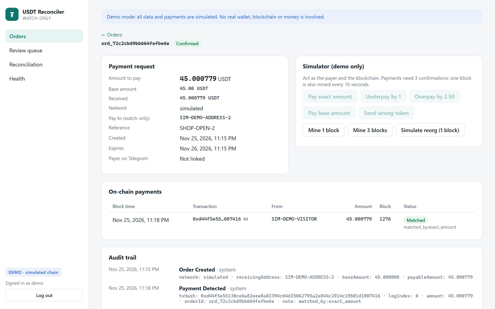
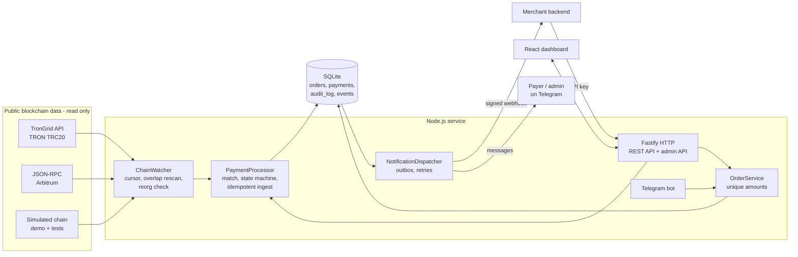
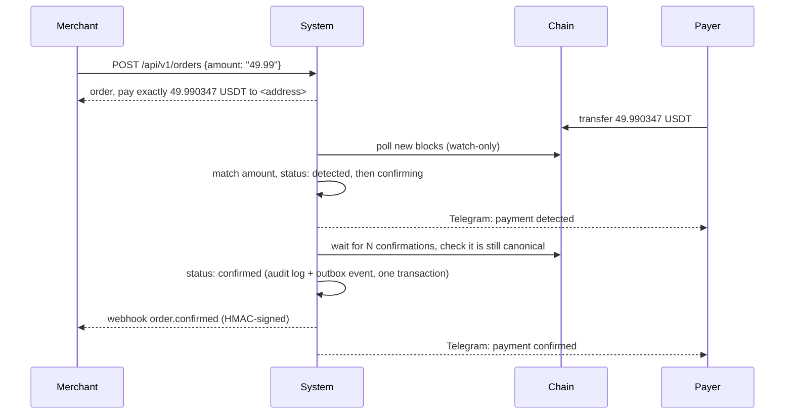
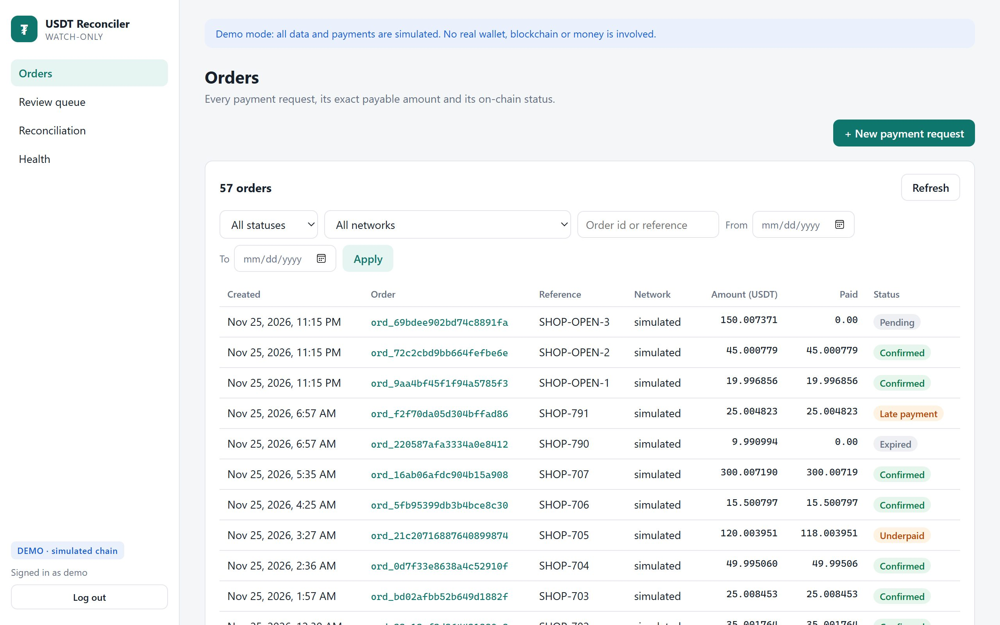
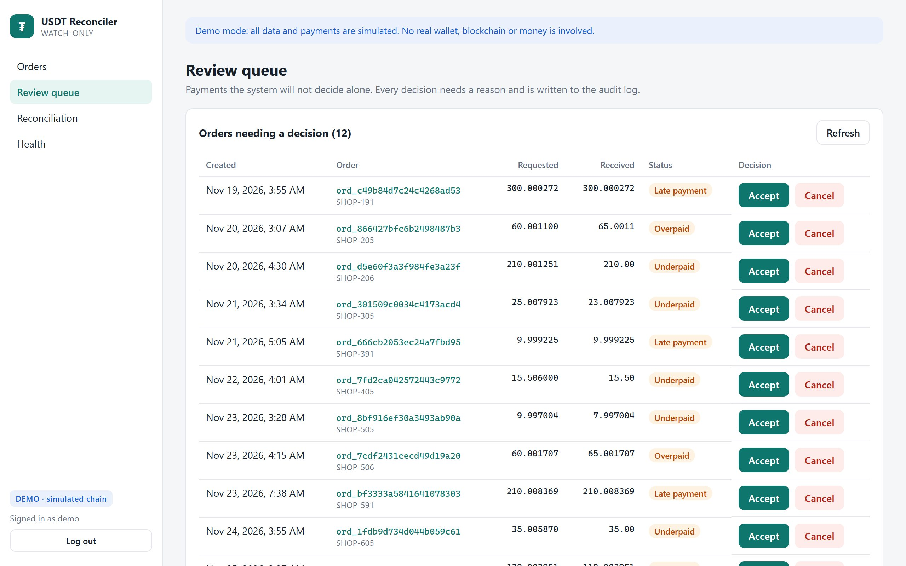
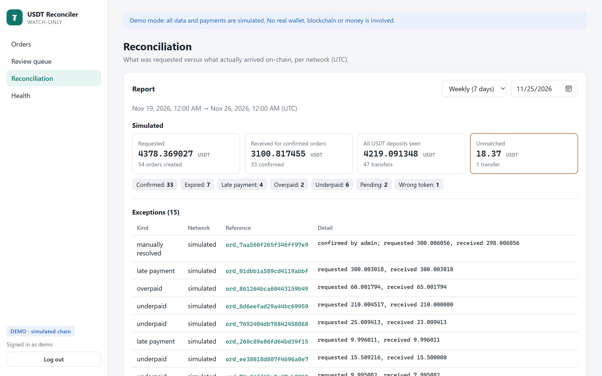

# USDT Payment Verification & Reconciliation System

Detects incoming **USDT** deposits on **TRON (TRC20)** and **Arbitrum**, matches each one to an order,
waits for safe confirmations, notifies the payer and the merchant (Telegram + signed webhook), and
produces daily and weekly **reconciliation reports** with a review queue for every problem payment.

**Non-custodial and watch-only:** it reads public blockchain data only. It never holds, asks for or
stores a private key or seed phrase, and contains no signing code.

**▶ Live demo:** https://usdt-payment-reconciler-demo.onrender.com
(simulated chain, no real funds; the login is shown on the page. Free hosting: the first visit after a
quiet period can take up to a minute to wake up.)



---

## What it does

| Problem a merchant has | What the system does |
| --- | --- |
| "Which customer sent this 50 USDT?" | Each order gets a **unique payable amount** (e.g. `49.990347`), so a deposit maps to exactly one order. Fallbacks: base amount, single open order, otherwise *unmatched*. |
| "Is the payment final?" | Waits for N confirmations (TRON 19, Arbitrum 20 by default) and re-checks recent payments for **chain reorganizations**. |
| "They sent too little / too much / too late / the wrong token" | Separate statuses (`underpaid`, `overpaid`, `late_payment`, `wrong_token`, `unmatched`) land in a **review queue**. A human decides, with a written reason. |
| "Did we receive what we asked for this week?" | **Reconciliation report** per network: requested vs. received, every exception listed, CSV export. |
| "My server slept / restarted" | Watchers resume from a cursor saved in the database and catch up; notifications use an **outbox** with retries, so nothing is lost or sent twice. |
| "Tell my shop backend when it's paid" | One **HMAC-SHA256 signed** `order.confirmed` webhook per order, with replay protection. |

Orders can be created from the **dashboard**, the **REST API** or the **Telegram bot** (`/neworder`).

## Architecture



### Payment lifecycle



Full state machine and rules: [docs/state-machine.md](docs/state-machine.md).

## Screenshots

| Orders | Review queue | Reconciliation |
| --- | --- | --- |
|  |  |  |

## Engineering decisions

- **No floating point for money.** Amounts are `bigint` base units (USDT has 6 decimals), stored as
  text and sent over the API as decimal strings. `0.1 + 0.2` problems cannot happen.
- **Idempotent by design.** A transfer is identified by `(network, tx_hash, log_index)` with a unique
  constraint; re-scanning blocks (which the watcher does on purpose) never double-counts.
- **Explicit state machine.** Every status change is validated; illegal ones are refused and logged.
  `confirmed` is final; a reorg deeper than the confirmation depth raises a critical alert instead of
  silently un-confirming.
- **Append-only audit log.** SQLite triggers block `UPDATE`/`DELETE` on `audit_log`.
- **Transactional outbox.** The status change and its notification event are written in the same
  database transaction; a dispatcher delivers them with deduplication and exponential backoff.
- **Pluggable chains.** One `ChainAdapter` interface; TRON, EVM and the simulator implement it.
- **Data layer behind an interface** (`Store`), currently SQLite (`node:sqlite`, no native module).
- **Contract addresses verified on-chain,** never typed from memory (see below).

## Security

- Watch-only: public addresses only. The config loader **rejects** anything that looks like a private
  key or seed phrase.
- No secrets in the code or history: `.env` is git-ignored from the first commit; **gitleaks** runs as a
  pre-commit hook and scans the whole folder and git history before every push.
- Admin passwords hashed with **bcrypt**; sessions are random 256-bit ids stored only as SHA-256 hashes,
  in an `HttpOnly`, `Secure`, `SameSite=Strict` cookie; **CSRF token** required on every change.
- **Password management**: change password in the dashboard (needs the current password and logs out
  every other session); **forgot password** sends a one-time code to the admin's Telegram chat (only
  its hash is stored, 15-minute expiry, single use, burned after 5 wrong tries, at most 3 per hour, same
  answer for unknown usernames); an **emergency reset** via `ADMIN_RESET_PASSWORD` for the server owner.
  All of it is written to the audit log. Turned off in the public demo, where the account is shared.
- **Rate limits** (login: 5/min, merchant API: 60/min, global: 300/min), input validation with zod,
  security headers (CSP, HSTS, no framing), 16 KB body limit.
- Webhooks: HMAC-SHA256 over timestamp + body, constant-time comparison, 5-minute replay window.
- CSV exports neutralise spreadsheet formulas (CSV injection).

Details and the final checklist: [SECURITY.md](SECURITY.md).

## Verified USDT contracts

| Network | Contract | Official source |
|---|---|---|
| TRON mainnet | `TR7NHqjeKQxGTCi8q8ZY4pL8otSzgjLj6t` | [tether.to](https://tether.to/en/supported-protocols/) |
| TRON Nile (testnet) | `TXYZopYRdj2D9XRtbG411XZZ3kM5VkAeBf` | [Nile faucet](https://nileex.io/join/getJoinPage) |
| Arbitrum One (USD₮0) | `0xFd086bC7CD5C481DCC9C85ebE478A1C0b69FCbb9` | [USDT0 docs](https://docs.usdt0.to/technical-documentation/deployments) |
| Arbitrum Sepolia | none: no official deployment exists | (a self-deployed token must be labelled UNVERIFIED) |

`npm run verify:contracts` checks contract code, name, symbol and decimals on-chain.

## Testing: what was actually run

- **127 automated tests** (Vitest) covering money arithmetic, matching, the state machine, the full
  payment flow on the simulated chain (underpay, overpay, late, expiry, duplicates, reorgs, restart
  catch-up), notifications and webhook signatures, the HTTP API (auth, CSRF, rate limits, idempotency,
  validation, password change and reset), reports and CSV export.
- **Chain adapters** are tested against **recorded real responses** from TronGrid and an Arbitrum One
  RPC (`tests/fixtures`), with no network access during tests.
- **Live read-only end-to-end check** (`npm run e2e:readonly`): finds a real recent USDT transfer on
  TRON Nile, TRON mainnet and Arbitrum One, creates a matching order and runs it through the real
  watcher to `confirmed`. It passed on all three networks during development. No funds are moved.
- The **public demo** was checked in a browser after deployment (login, simulated payment to
  `confirmed`, CSRF rejection, health page).

Not done (yet): a real payment from a wallet on testnet, a test with a real Telegram bot token, load or
performance testing. No performance numbers are claimed.

## Run it locally (demo mode, no wallet or API keys)

Requires Node.js 22.13 or newer.

```bash
npm install
npm run dashboard:install
npm run dashboard:build
npm run dev                # http://localhost:3000, APP_MODE=demo by default
```

Other commands:

```bash
npm run typecheck
npm test
npm run scan:all           # secret scan: folder + full git history
npm run dashboard:dev      # dashboard with hot reload on :5173 (API proxied to :3000)
npm run verify:contracts   # verify USDT contracts on-chain (read-only)
npm run e2e:readonly       # live end-to-end check on public chain data, no funds
```

Configuration is documented in [.env.example](.env.example). Deployment (free demo on Render, or a
real merchant install): [docs/DEPLOYMENT.md](docs/DEPLOYMENT.md).

## HTTP API (summary)

| Endpoint | Auth | Purpose |
| --- | --- | --- |
| `POST /api/v1/orders` | `Authorization: Bearer <MERCHANT_API_KEY>` | Create a payment request. Supports `Idempotency-Key`. |
| `GET /api/v1/orders/:id` | API key | Order status and matched payments. |
| `/admin/api/*` | Session cookie + `X-CSRF-Token` | Dashboard API: orders, review queue, reports, CSV export, health, password change. |
| `POST /admin/api/password/forgot`, `/password/reset` | none (strict rate limit) | Forgot password: one-time code sent to the admin Telegram chat. |
| `GET /healthz` | none | Liveness check. |

```bash
curl -X POST https://your-host/api/v1/orders \
  -H "Authorization: Bearer $MERCHANT_API_KEY" \
  -H "Idempotency-Key: checkout-1042" \
  -H "Content-Type: application/json" \
  -d '{"amount":"49.99","network":"tron","external_ref":"INV-1042"}'
```

Webhook verification example for the merchant side: [examples/webhook-receiver.ts](examples/webhook-receiver.ts).

## Tech stack

TypeScript, Node.js, Fastify, SQLite (`node:sqlite`), zod, grammY (Telegram), React + Vite, Vitest,
gitleaks. Hosted on Render (free plan) for the demo.

## Limitations (honest list)

- **Not audited and not production-hardened.** Review it yourself before any real use.
- Confirmation depth on Arbitrum is about the L2 sequencer, not Ethereum L1 finality.
- An underpaid order that is later topped up needs the admin to assign the second payment.
- Only SQLite is implemented; a Postgres store would be a new `Store` implementation.
- One process: watcher, bot and API run together, sized for a small merchant.

## How it was built

Built with AI-assisted development; see [docs/HOW_I_BUILT_IT.md](docs/HOW_I_BUILT_IT.md).

## Disclaimer

This is a portfolio project provided "as is", without warranty of any kind (see [LICENSE](LICENSE)).
It is not financial, legal or tax advice. It does not custody funds and cannot recover mistaken
transfers. Mainnet mode only reads public data and is clearly labelled; all end-to-end payment tests
use testnets or the simulated chain.

## License

[MIT](LICENSE)
