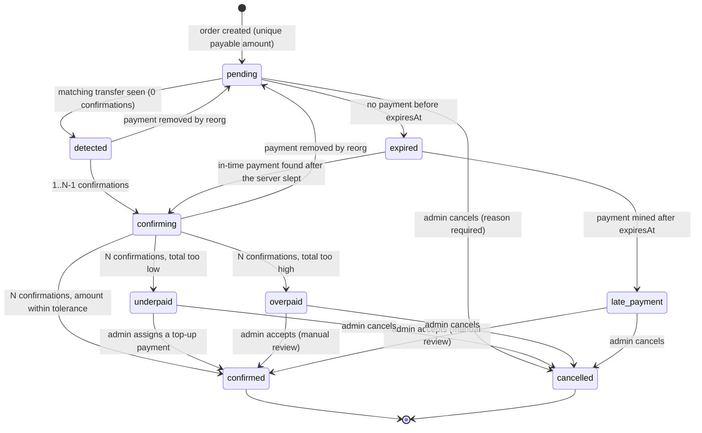

# Order state machine

Payment (deposit) statuses: `matched`, `unmatched` (review queue), `wrong_token`, `orphaned` (removed by a reorg),
`dismissed` (an admin decided an unmatched or wrong-token transfer needs no order, with a reason).

Rules enforced in code (`src/core/stateMachine.ts`, `src/core/status.ts`):

- Every transition is validated; illegal ones are refused and logged as `transition_blocked`.
- `confirmed` and `cancelled` are final. A reorg deeper than the required confirmations does **not** silently
  un-confirm an order: it raises a critical `reorg_after_final` alert for a human.
- Only orders in the review queue (`underpaid`, `overpaid`, `late_payment`) can be accepted manually,
  and a written reason is required. Every change is recorded in the append-only `audit_log` table.
- Idempotency key for a transfer: `(network, tx_hash, log_index)`.
